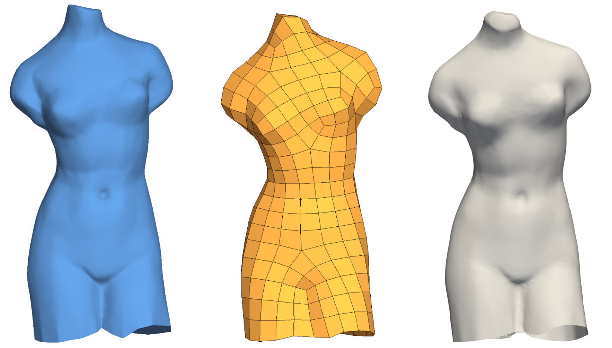

This is the source code of my thesis titled:
# Surface reconstruction from point clouds to polygonal meshes and remeshing
for the Aristotle University of Thessaloniki, in coloration with inria Sophia-Antipolis.

We are concerned with creating a coarse quad mesh from a triangle mesh, providing good quality topology.
We define a parameter space on each face and provide a projection algorithm that would map points from the original 
detailed model to the parameter space of the coarse layout mesh. 
The mesh can then be used to create a $G^1$ B-Spline surface, using [[1]](#1).
The triangle meshes can be reconstructed from a point cloud, thus we have a full pipeline from physical objects to 
spline surfaces.





To generate the coarse quad mesh a modified version of Nico Pietroni's [*quadwild*](https://github.com/nicopietroni/quadwild) code is used.

The parametrization is coded on the [G+Smo](https://gismo.github.io/) library. 


---

Explanation on how to install ans use the modified quadwild script provided below, copied from the original readme file:


### Build
Install the libraries boost and gurobi. 
In Ubuntu you can install boost easily with the following terminal commands:
```
apt-get install libboost-dev
```
Open the file libs/libs.pri and set the paths of the requested libraries and the gurobi parameters:
```
#External libraries
BOOST_PATH          = /usr/include/boost/
GUROBI_PATH         = /opt/gurobi950/linux64/
GUROBI_COMPILER     = gurobi_g++5.2
GUROBI_LIB          = gurobi95
```

<br/>

If you do not need CoMISo, you can simply remove the define `COMISO_FIELD` in the file libs.pri:
```
#DEFINES += COMISO_FIELD
```
However, for organic meshes, we suggest to abilitate CoMISo. You need to compile it along with its dependencies (BLAS):
```
apt install libblas-dev
cd quadwild/libs/CoMISo
mkdir build
cd build
cmake ..
make
```

<br/>

You can now compile the project quadwild/quadwild.pro with qmake or QtCreator.

In case you have technical issues or building problems, please write to [stefano.nuvoli@gmail.com](mailto:stefano.nuvoli@gmail.com) or [nico.pietroni@uts.edu.au](mailto:nico.pietroni@uts.edu.au).

### Run
The package is composed of the main command-line quad-remesher (quadwild) and three different components (field_computation, field_tracing, quad_from_patches) that perform different steps of the pipeline.

---

#### quadwild
This project has no visual interface and can be used via command-line. This can be helpful to batch run entire datasets of models. To run the project, once builded, execute the following terminal command:
```
./quadwild <mesh> [.txt setup file] [.rosy file] [.sharp file]
```
The command takes as input a mesh and three optional configuration files:

- **`<mesh>`**: filename of the input triangle mesh. **The mesh can be either an obj or a ply.**
   
- **`.txt setup file` (optional):** The txt setup file contains the parameters in the pipeline. By default, the executable loads the file basic_setup.txt and two other examples are included: basic_setup_mechanical.txt and basic_setup_organic.txt. Any setup parameter can be specified to control the output result. The setup file has the following fields:
```
do_remesh 1 		  //remesh (1) or not (0) the input mesh
sharp_feature_thr 35      //the dihedral angle of sharp features (-1 no features)
alpha 0.02                //regularity vs isometry of the final tessellation. Close to zero -> more regular, Close to 1 -> more singularity are inserted
scaleFact 1               //the scale of the final quadrangulation (the bigger the bigger the quads)
```

- **`.rosy file` (optional)**: This optional file contains parameters for the field computation of the field.
```
fn              //number of faces of the mesh
4               //directions of the field (always 4 for a cross-field)
x0 y0 z0        //XYZ directions of one vector of the cross-field of the first face
...
xn yn zn        //XYZ directions of one vector of the cross-field of the n-th face
```

- **`.sharp file` (optional)**: This optional file contains the informations of the sharp features. Note that, in the pipeline, border edges are considered sharp features by default.
```
sn                //number of sharp features
t0 f0 e0          //for each sharp edge: the first integer is 0 if the edge is concave 1 if convex, then the face and the index of the sharp edge
...
tn fn en          //nth sharp edge
```

The output of quadwild consists of several files:
- **The output smooth quadrangulation (suffix quadrangulation_smooth.obj).**
- The output quadrangulation before being smoothed (suffix quadrangulation.obj).
- Other files:
  - The re-meshed triangulated mesh (suffix rem.obj), the relative field and the sharp features automatically computed (.rosy and .sharp files as above).
  - The mesh decomposed after the tracing (suffix rem_p0.obj).
  - The patch decomposition (.patch file) contains the patch index for each triangle of the rem_p0 mesh.
  - The files .corners, .c_feature, .feature files that contain per patch information (respectively corners of each patch, corners to be fixed and feature lines on the patches).

---

#### field_computation. 
The program can be used either with a GUI or by command line (useful to batch run entire datasets of models).
```
./field_computation <mesh> [.txt setup file] [.rosy file][.sharp file] [batch]
```
The "batch" option makes the program run in the shell without the GUI. The setup file includes additional parameters. By default, the executable loads the file basic_setup.txt.

---

#### field_tracing
This program is used to trace fields and split the mesh into patches.
```
./field_tracing <mesh> [.txt setup file] [batch]
```
It requires having a .rosy and a .sharp file (with the same name of the mesh file). The "batch" option makes the program run in the shell without the GUI. The setup file includes additional parameters. By default, the executable loads the file basic_setup.txt.

---

#### quad_from_patches
This program is used to obtain a quadrangulation from a patch decomposition.
```
./quad_from_patches <mesh> [.txt setup file]
```
It requires to have in the same folder a .corners, .c_feature, .feature files (with the same name of the mesh file). The setup file includes additional parameters. By default, the executable loads the file basic_setup.txt.

## License
[GPL3](LICENSE) licensed
([FAQ](https://www.gnu.org/licenses/gpl-faq.html))


--- 

The parametrization code has to be compiled with [G+Smo](https://gismo.github.io/). 

The fitting code is closed source as of now. 

--- 
## Example of how to run the pipeline on a .obj file

Let's assume the triangle mesh mesh.obj. The command

```
quadwild mesh.obj
```

will create the coarse quad mesh: mesh_quadrangulation.obj or mesh_quadrangulation_smooth.obj

The smooth version refers to the last smoothing step of Pietroni's method.

The above line will create all necessary files for the parametrization. Running in the same directory:

```
projection_cc mesh
```

- notice no suffix 

 will create the parametrization in a form readable by the fitting B-spline script...

additional options:

```
projection_cc mesh --fd
```

to fix degeneracies.

```
projection_cc mesh --smooth
```

to use the smoothed quadrangulation mesh instead of the plain. 
 
---


## References
<a id="1">[1]</a> 
Michelangelo Marsala, Angelos Mantzaflaris, Bernard Mourrain,
G1 spline functions for point cloud fitting,
Applied Mathematics and Computation,
Volume 460,
2024,
128279,
ISSN 0096-3003,
https://doi.org/10.1016/j.amc.2023.128279.
(https://www.sciencedirect.com/science/article/pii/S0096300323004484)
